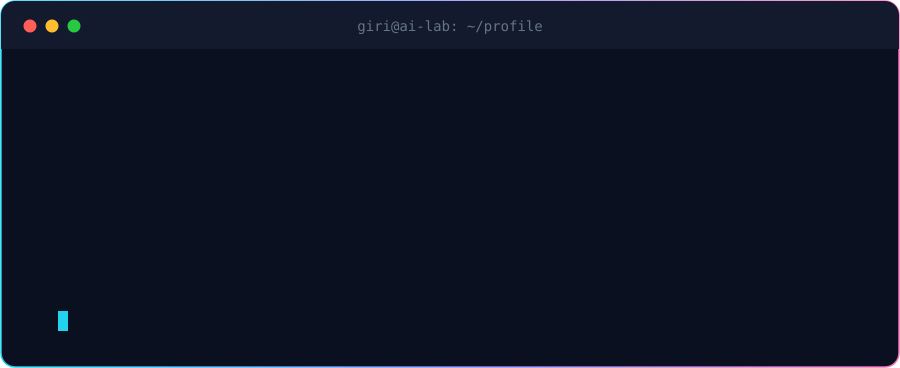
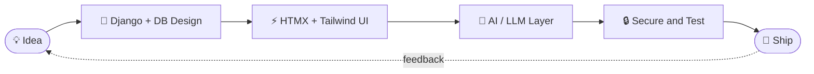

<div align="center">



<br/>

[](https://linkedin.com/in/giri-dharan-a608b9259)
[](mailto:zeefer2000@gmail.com)
[](https://drive.google.com/file/d/1yr4NEZNI-I81Nr12pTk15PxNkSAl_LAN/view?usp=drive_link)
[](https://github.com/gd0810?tab=followers)

<br/>




</div>

## 🧬 `class Giridharan:`

```python
class Giridharan:
    roles     = ["Python Developer", "AI Engineer"]
    backend   = ["Django", "MySQL", "PostgreSQL", "SQLite"]
    frontend  = ["HTMX", "Tailwind CSS", "JavaScript", "Chart.js"]
    ai_stack  = ["PyTorch", "TensorFlow", "OpenCV", "Pandas", "LLMs"]

    building  = "Chtbot"
    learning  = ["AI / LLM", "AI Automation"]
    mindset   = "scalable · secure · maintainable"

    def build(self, idea):
        return self.design(idea) | self.ship() | self.iterate()

    def __repr__(self):
        return "Turning ideas into production-ready AI-powered web apps."
```

<div align="center"></div>

## ⚡ What I Do

<table>
<tr>
<td width="33%" valign="top">

### 🐍 Backend Engineering
Django applications with clean architecture, solid database design (MySQL / PostgreSQL) and secure, role-based access.

</td>
<td width="33%" valign="top">

### 🤖 AI & Automation
Exploring LLMs and AI automation, plus computer vision with OpenCV, to build chatbots and smart workflows.

</td>
<td width="33%" valign="top">

### 🎨 Responsive Interfaces
Fast, real-time UIs with HTMX and Tailwind CSS, with no heavy front-end frameworks needed.

</td>
</tr>
</table>

<div align="center"></div>

## 🛠️ Tech Arsenal

<div align="center">

**Languages & Core**


**Web & Backend**


**Databases**


**AI / Data**


**Tools**


</div>

<div align="center"></div>

## 🚀 Featured Projects

<table>
<tr>
<td width="50%" valign="top">

### 🤖 [Chtbot](https://github.com/Gd0810/chatbot)
An AI chatbot project, currently in active development as I dive deeper into LLMs and AI automation.


</td>
<td width="50%" valign="top">

### 📋 Enquiry Management System
A full Django web app with **role-based dashboards** and **real-time form handling** powered by HTMX.


</td>
</tr>
</table>

<div align="center"></div>

## 🧭 How I Build



<div align="center"></div>

## 📊 GitHub Stats

<div align="center">


</div>

<div align="center"></div>

## 💬 Fun Fact

```python
>>> a, b = [1, 2], [1, 2]
>>> a == b
True
>>> a is b
False   # Python devs have trust issues with `is` 😅
```

## 📫 Let's Connect

I'm open to collaborations, internships and interesting AI / web projects.

<div align="center">

[](mailto:zeefer2000@gmail.com)
[](https://linkedin.com/in/giri-dharan-a608b9259)


<sub>Built with Python, curiosity and too much coffee ☕</sub>

</div>
